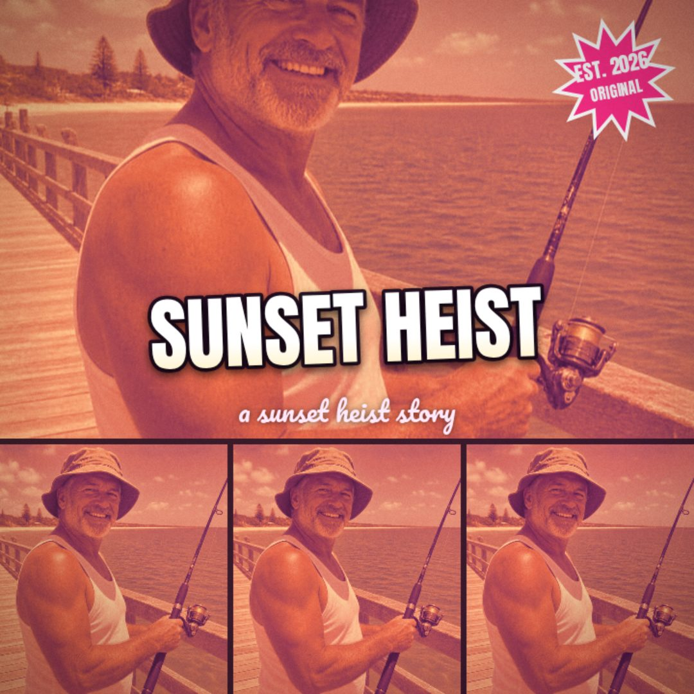
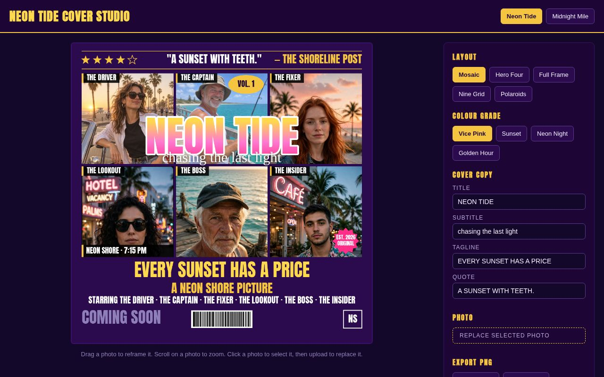
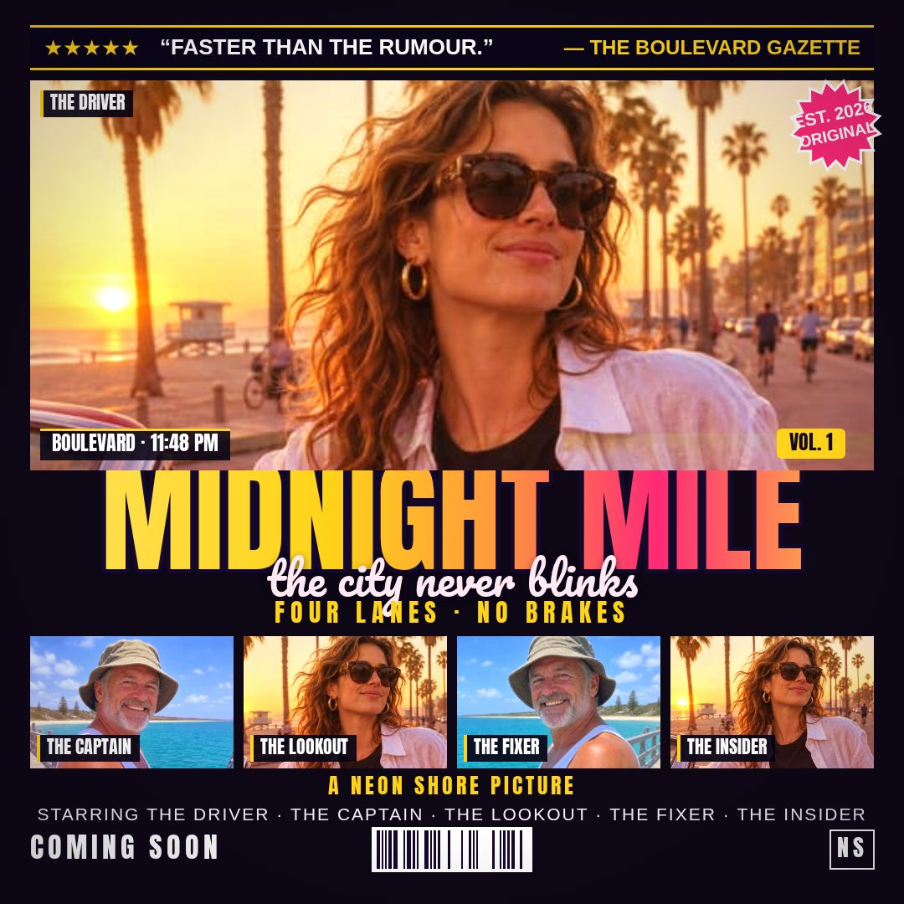

# Neon Tide — Cover Studio

[](https://make.fun/bounty/gta6-cover-art-01)
[](https://make.fun/bounty/gta6-cover-art-01)
[](https://make.fun/bounty/gta6-cover-art-01)

Turn any photo and a caption into a GTA 6-style poster cover, entirely
offline. Pick a photo, type the copy, and export a print-ready PNG —
nothing ever leaves your browser.

## What it does

- **Five layouts** — Cast Grid (big hero + four cast cells), Hero Four,
  Full Frame, Nine Grid and Polaroids.
- **Face-safe crop** — the crop window centres on the face (measured at 30%
  from the top of the frame). Drag to reframe, scroll to zoom, per cell.
- **Editable everything** — title, Pacifico subtitle, tagline, quote bar
  with 1–5 stars and source, place / time strip, and every cast label.
- **Billing block** — the "STARRING …" line is generated from the labels
  actually visible in the current layout, de-duplicated.
- **Three colour grades** — Sunset, Neon Night and Golden Hour.
- **Three exports** — 1080 × 1080, 1080 × 1350 and 1920 × 1080 PNG.

## Run it

```sh
node serve.ts
# open http://localhost:8080/
```

No build step, no dependencies, no network calls at runtime. The two
bundled fonts (Anton and Pacifico, SIL OFL 1.1) and the two kit sample
photos live under `app/`.

## Files

| Path | What it is |
| --- | --- |
| `app/index.html` | Editor shell, zero external references |
| `app/style.css` | Dark neon editor theme |
| `app/src/cover.js` | Poster render engine (canvas) |
| `app/src/grades.js` | Sunset / Neon Night / Golden Hour palettes |
| `app/src/main.js` | Editor wiring, presets, `?shot=` scenes, export |
| `app/fonts/` | Anton + Pacifico (OFL) |
| `app/samples/` | Kit sample photos (pier, boulevard) |
| `main.ts` | Writes the make.fun dossier (`dossier.json`) |
| `serve.ts` | Static server on :8080 |

## Screenshots





## License

MIT — see `LICENSE`. Fonts under the SIL Open Font License 1.1
(`app/fonts/OFL.txt`). Not affiliated with Rockstar Games; no Rockstar
logos, artwork or fonts are used.
